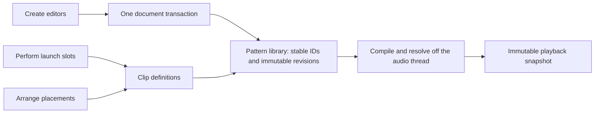

# T1-03: shared clip and pattern model

Status: design proposal. Increment A (the identity and library model) is implemented in
[ClipLibrary.h](../src/ClipLibrary.h) with ClipLibraryTests (#111). Increment B is split in two:
B1 (Session cells owned by the library), B2a (linked cells, saved links, make unique) and B2b
(placement clips) are implemented; increments C-E are not started.
Baseline: main `1587c17` (project format 17). Roadmap source: T1-03 in
[PR #100](https://github.com/ryanschrang/AlienStudio/pull/100), workstream
ARCH-01 / LIVE-03. The numbered priority plan is not yet on this baseline's
`docs/ROADMAP.md`. T1-02's Command Engine can supply the transaction interface;
T1-04's universal tracks should build on these identity and binding boundaries.

## Outcome and first delivery

A pattern authored in Create is the same musical object when launched in
Perform and placed in Arrange. An edit made through any of those views updates
all intentionally linked uses after one document transaction. Placement edits
such as moving, trimming or fading one region do not edit the shared source.
Independent copies remain independent. Save/open and undo preserve these rules.

This first delivery is the design and implementation contract. It does not
claim that sharing a note pointer already completes T1-03. Implementation is
split into reviewable increments below, with explicit tests before each cutover.

## What exists today

| Concern | Evidence on the baseline | Consequence |
| --- | --- | --- |
| Session source | `SessionClip` in [ProjectDocument.h](../src/ProjectDocument.h) owns immutable note/audio references in a `[scene][track]` table. | A cell is the source identity; pointers identify revisions in memory, not persisted musical objects. |
| Arrange source | `timeline::Region` in [Timeline.h](../src/Timeline.h) stores `row` and `source`: track/scene for Session, or rack lane/pattern index. | Reorder/delete must remap indices. Two regions using one Session cell already hear its edits. |
| Song snapshot | `captureArrangement()` in [ProjectController.h](../src/ProjectController.h) shares Session notes into [Arrangement.h](../src/Arrangement.h). | LIVE-03 removed large note copies from song/save snapshots; it did not create a source registry. |
| Create source | `rack::Project` / `rack::Pattern` in [RackModel.h](../src/RackModel.h) hold a pattern bank, steps and optional full-note rows for multiple channels. | Rack patterns are composite content, not interchangeable with a single Session note sequence. |
| Authoritative rack data | A non-null `Pattern::notes[channel]` is authoritative; its step row stays dormant. [RackChannelNotes.h](../src/RackChannelNotes.h) explicitly labels notes-to-steps conversion lossy. | A migration must keep both representations and their authority flag; flattening notes to steps loses chords, overlaps and timing. |
| Rack copies | `addPattern(copyFrom)` initially shares an immutable pattern; `Project::edit()` copies it on mutation. | Pointer sharing means cheap independent copies, not a promise of linked editing. |
| Editing/history | `setClipPattern()`, `setRackChannelNotes()` and `editRack()` update different owners. [DocumentHistory.h](../src/DocumentHistory.h) snapshots the document. | Cross-view edits need one ownership and transaction boundary, with existing gesture coalescing retained. |
| Save data | [SessionProject.h](../src/SessionProject.h) stores Session notes in scenes; [RackProject.h](../src/RackProject.h) separately stores rack steps and note rows. | Save data cannot currently express a shared Session/rack source relationship. |
| Limits | 16 Session tracks, 32 scenes; rack has 64 channels, 64 patterns and 128 steps. Piano-roll notes allow 1,024 notes and loops up to 256 steps. | Preserve these limits initially. Do not silently truncate a Session sequence to fit a rack editor. |

Source inspection establishes these contracts; it is not new hardware or
listening verification. Existing tests remain the behavioral baseline.

## Decision: content, clip definitions and placements are different things

Introduce one project-owned library of immutable pattern revisions. Each view
holds IDs into that library rather than owning a separate musical copy. Keep
the project document as the sole editable authority on the message thread.

| Proposed object | Identity and owned data | References / exclusions |
| --- | --- | --- |
| `PatternRecord` | Stable `PatternId`, revision, immutable `PatternData` containing length and lanes. | No plugin instances, row indices, mutable UI selection or audio-device handles. |
| `PatternLane` | Stable `LaneId` scoped to the pattern; typed content. | Lane identity survives channel reorder. Playback destinations are bound outside the content. |
| `ClipDefinition` | Stable `ClipId`, `PatternId`, display metadata, default playback settings and lane bindings. | A single source usable by launch slots and arrangement placements. Devices/routing stay owned by existing track/channel models. |
| `LaunchSlot` | Existing track/scene layout plus an optional `ClipId`. | Coordinates describe layout, not source identity. Empty default slots need no note allocation. |
| `Placement` | Region identity, `ClipId`, destination/lane context, start, length, source offsets, loop/mute, gain, fades, crossfade and group. | Each placement owns its edits. These properties must not become shared pattern properties. |
| `MediaRecord` | Stable media reference plus saved path/collection metadata. | Decoded audio and streaming readers remain runtime resources with explicit lifetime owners. Missing media remains an offline audio reference. |

Use distinct typed, project-scoped, nonzero 64-bit IDs, persisted as 16-digit hex
strings, with uniqueness checked per ID type. Do not reuse plugin instance IDs,
note IDs, pointer addresses or container positions. Import assigns missing IDs
once; ordinary edits retain IDs. A pattern revision changes when content changes;
it is not a new pattern identity. Undo restores the prior revision and bindings.
Note IDs stay local to their lane. Shared empty data can use a common immutable
payload without making independently authored empty patterns the same identity.

### Content is typed, without flattening rack patterns

A Session MIDI source is a pattern with one note lane. A rack pattern is a
pattern with multiple lanes. A Session audio source is an audio lane referencing
media; a rack sampler channel remains a note/step lane driving its existing
device, not an audio clip produced by rendering that sampler.

For a rack lane, preserve:

- its authoritative mode (steps or full notes), the full note sequence and the
  dormant step row; clearing a note row is an explicit operation;
- all step fields, including values on disabled steps and beyond the audible
  length: velocity, pan, pitch, probability, gate, nudge and ratchets;
- note pitch, start/end ticks, velocity, probability, overlaps and chords;
- pattern length and the existing channel binding, sample/synth choice, mixer
  output, mute/solo, choke and swing behavior through the device/binding adapters.

Time uses the existing 960 ticks per quarter note / 240 ticks per sixteenth.
Tempo/time-signature maps (T1-01) convert time for rendering; the library does not
own a second transport clock. Rack step pitch remains relative to root MIDI 60;
Session note pitch remains absolute. Only the existing rack adapter performs
that conversion. Never infer a one-step note from gate/ratchet/nudge metadata.
Do not use `stepsFromNotes()` as a save, edit-commit or migration path.

A view may reject an unsupported edit with a clear reason; it must still retain
and display the source without clipping it to the view's grid limits. Expanding
note, channel or track limits is a separate capacity change.

### Sharing and copy semantics

| User operation | Identity rule | Effect of a later note edit |
| --- | --- | --- |
| Place a clip in Arrange | New placement, same `ClipId` and `PatternId`. | All uses of that clip hear the edit, including its Perform slot. |
| Duplicate an Arrange placement | New placement, same source; placement properties copied by value. | Source edits remain linked; moving/trimming the copy affects only that placement. |
| Duplicate a clip/pattern | New `ClipId` and new `PatternId`; immutable payload may be shared until edited. | Independent, matching current rack-pattern copy behavior. |
| Linked duplicate | New `ClipId`, same `PatternId`, copied bindings/defaults. | Content stays linked; clip metadata/bindings can differ. This is explicit, never inferred from equal notes or pointers. |
| Make clip unique | Rebind that `ClipId` to a fresh `PatternId` holding the current content. | Every use of this clip follows the fork; other clips sharing the former pattern do not. |
| Make one placement unique | Create a new clip and pattern, rebind only the selected placement. | The launch slot and other placements keep the old source. |
| Clear a launch slot | Remove that slot's clip reference. | Existing arrangement placements keep their source; deleting the musical object is a distinct operation. |

Legacy scene/clip duplication must retain its existing independent-edit behavior.
Do not change old documents into linked duplicates merely because their snapshots
happen to share a `shared_ptr`. The UI must distinguish duplicate from linked
duplicate and explain the scope of Make unique.

## Editing and Command Engine boundary

Create, Perform and Arrange editors resolve a selected `ClipId` to the same
`PatternId`. They submit edits through one service owned by ProjectController;
there are no separate writable note caches in views.

A transaction receives the target IDs and expected content revision, builds a
new immutable revision, validates it and its references, and commits one complete
ProjectDocument state. On stale revision, fail or explicitly rebase a compatible
edit; do not overwrite newer edits silently. Validation failure leaves document,
history, selection and published playback unchanged. Gestures retain the existing
coalesce-key behavior and produce one undo step.

T1-02 can expose operations such as `EditPattern`, `DuplicateClip`,
`LinkClip`, `MakeClipUnique` and `DeleteClip`. These are proposed contracts, not
existing command classes. Until that engine lands, use a thin controller adapter
with the same transaction boundary; do not create a second command/history engine
inside T1-03. Existing recording ownership and frozen-source edit guards still
apply before committing content edits.

Changes to track instruments, plugin state or routing do not revise musical
content. Moving a lane binding retains the pattern. Deleting a channel/track must
not bind orphan content to whichever new object occupies the same index.

## Playback and lifetime contract

Resolve IDs, validate bindings and compile bounded scheduler inputs on the
message/offline preparation thread. The audio thread receives one immutable
snapshot generation covering the pattern revisions, launch mappings, arrangement
placements and device bindings required by that generation. Publishing separate
new-content/old-binding generations is not an acceptable intermediate state.

Keep the proven producer-owned retirement model from ArrangementMailbox and
rack::SnapshotMailbox. The callback swaps/reads pointers or pre-resolved indices;
it performs no library edits, hash-table rebuilding, allocation, locking, file
I/O, logging or final destruction of pattern/media ownership. Offline export
holds the same resolved generation for the whole render. Controller/media owners
keep decoded assets and streaming resources alive through all readers.

Sharing content must not share playhead or voice state. Each playback occurrence
has its own playhead, pending events, loop iteration and note ownership. Stopping
one occurrence releases only its notes. Stop, panic, seek, source replacement,
loop wrap and device changes must retain explicit note-off behavior. Preserve
current same-layout republish continuity and use the existing bounded schedulers
first; this is not a reason to replace every scheduler in one PR.

Compile note/step content once per referenced pattern revision where possible;
instance-local state remains bounded by the existing track/rack/voice capacities.
A library must not recreate a fixed-capacity note array for every empty grid cell
or every arrangement placement. Measure snapshot/history memory and callback
work before changing limits (T1-04).

## Files, migration and recovery

Allocate the next available project format version when the persistence PR ships;
do not reserve a number in this design. Baseline formats 1–17 remain loadable.
New writers use library tables and ID references; old readers must refuse the new
version rather than silently discarding links. No dual writable scene/rack note
stores are allowed after cutover. Legacy adapters are import/read or generated
views, never a second authority.

Migration runs on temporary data and is installed only after complete validation:

1. Import each legacy Session source cell into its own clip/pattern identity
   when it has content or nondefault source metadata. Two regions referencing
   one cell bind to the same clip. Separate cells stay independent even if their
   notes are identical or were pointer-shared in memory.
2. Import each rack bank slot as one composite pattern/clip, retaining lane mode,
   dormant steps, length and per-channel note data. Separate bank slots remain
   independent even when `addPattern(copyFrom)` shared their old storage.
3. Build stable track/channel/scene bindings without changing engine capacities
   or the existing routing. Replace region row/source lookup with explicit clip
   references while preserving every placement edit and its playback order.
4. Convert takes, active comps, frozen originals and cache references as well as
   audible regions. Retain original plugin instance IDs and parameter targets;
   freeze/unfreeze must restore the same musical source and processing identity.
5. Preserve offline media references, portable paths, source-relative audio
   offsets and missing-media recovery. Failed migration/import must leave the
   original file and currently open document intact. Never rewrite a file just
   because it was opened.

Validate unique IDs, reference existence/kind, timing and capacity limits, and
complete lane bindings. Preserve missing external media as an offline reference;
a dangling internal pattern reference is invalid, not permission to substitute a
similarly named clip. Stable IDs and explicit references make pointer/index
reconstruction unnecessary after reopening.

Deletion and pruning use reference roots from launch slots, placements, takes,
frozen originals, editor transactions and undo/redo snapshots. Clearing a slot
must not delete content still needed by Arrange or undo. History and in-flight
snapshots own prior revisions until readers release them off the callback. This
work does not introduce automatic deletion of media files.

## Delivery sequence and acceptance gates

| Increment | Change | Required evidence before cutover |
| --- | --- | --- |
| A: identity/library model | Pure C++ typed IDs, immutable revision registry, reference validation and copy/link/fork operations. Additive, with the current models still authoritative. No format bump yet. | Focused tests for identity, aliasing versus independent copies, revision conflicts, invalid references and transactional failure. A single empty payload must not imply shared authoring identity. |
| B: Session and Arrange | Controller adapter, source references, ID-based placements, library serialization and legacy migration. A complete implementation replaces the old Session write authority. | Save/open/portable/recovery/undo tests; same clip edit updates all linked placements; independent cells stay independent; clear/delete/reorder keep sources valid; offline media and freeze/takes survive. |
| B1: Session ownership | Every Session cell holds a `ClipId`; its notes and audio live only in the document's library and media table. All writes go through `ProjectDocument::setClip`/`clearClip` (an edit is a new revision of the cell's clip); reads get a resolved view. Duplicate scene makes independent clips; delete prunes. Song regions still name a cell, which holds exactly one clip, so no two cells can share a clip yet and the file format is unchanged: each saved cell opens as its own clip. | ProjectControllerTests (ownership, revisions, duplicate/move/delete/clear, undo/redo, audio media, save round trip) and every existing suite. |
| B2a: linked cells | Cells can share a pattern through distinct clips (Paste linked: `Library::linkClip`); Make unique (`makeClipUnique`) and Make placement unique (an independent copy in a free cell). Format 22 saves a `link` per cell whose content is shared; every cell still stores its content, and linked cells must match. Regions still name cells. | ProjectControllerTests (linked edits, independent paste, make unique, clear, undo, save/reopen, damaged and format 21 files, placement unique); SessionViewTests (Copy / link menu). |
| B2b: placement clips | A track region names either a cell (`source`) or a placement clip (`Region::clip`, a `ClipId`, `source` -1): MIDI content of the song's own that no cell launches. The song snapshot carries placement clips in a sorted list that the audio thread searches without allocating (`ArrangementPlayback::clipFor`). Regions with the same id share the clip; Make placement unique gives a MIDI placement a new one (audio placements keep the B2a free-cell copy); the piano roll edits it through the controller; the document keeps a clip while a region or frozen original names it; a paste restores a cut clip from what was copied. Format 24 saves `placementClips` (id, name, loop, notes) and a `clip` id per region; takes never name one. Cell regions still name cells: moving them to clip ids, and placement clips with audio, are left for D/E. | ProjectControllerTests (make unique without a cell, independent edits, shared copies, engine snapshot contents and refusal, scene deletion, pruning and undo, restore for paste, refused unknown ids, save/reopen with sharing and names, damaged and older files); TimelineViewTests (open by double-click and menu, cut/paste restore, copy/paste sharing). |
| C: Channel Rack | Import composite patterns into the same registry and edit via the service; retain step/note mode and device bindings. Remove the rack's independent musical write authority. | Full-note and step-expression parity, dormant/hidden steps, channel reorder/deletion, synth/sample routing, copy semantics, legacy bank migration and export comparison. |
| D: Create / Perform / Arrange integration | Open the same source from all views and launch composite rack clips through a bounded playback adapter. Launching is no longer tied only to the globally selected rack pattern. | End-to-end cross-view edit/launch/place test, linked versus unique behavior, independent playback-instance note ownership, quantized launch/stop, save/reopen and live/export parity. |
| E: cleanup and capacity handoff | Remove obsolete source-index ownership paths and document the extension points for universal tracks. | All existing regression suites pass; measured memory/callback costs justify T1-04 work. No capacity increase is implied by completing T1-03. |

Each increment is a separate feature branch/PR. A production document must never
contain two competing writable owners, even while older adapters remain during
the staged migration. A is preparatory only; B/C switch complete ownership paths,
not partial field synchronization. The new file version lands only with a complete
reader/writer migration for the data it moves.

## Completion checklist

T1-03 is complete only when all of these behaviors are demonstrated, not when
only the common struct or this proposal exists:

- Author one note pattern and one multi-channel rack pattern in Create, launch
  each in Perform, and place each in Arrange without copying musical content.
- Editing from each view updates every linked use; the other views reflect the
  new revision without transport restart. Undo/redo updates all views together.
- Independent duplicates and Make unique behave as the operation table specifies,
  including after save/reopen. No identity is inferred from content equality.
- Concurrent occurrences keep independent playheads/note ownership; stopping one
  cannot cut another off or leave stuck notes. Old/new revisions remain alive
  safely across publication and export.
- Session/rack MIDI timing, sample playback, offsets, fades/crossfades, swing,
  probability, gate/nudge/ratchet, stems, sends, freeze and take comps retain their
  existing tested behavior. Unsupported conversions fail without data loss.
- Legacy migration and portable/missing-media paths pass; no callback allocation,
  lock, I/O or ownership destruction is introduced. Memory scales with actual
  unique content and bounded playback instances, not grid capacity times notes.

Tests to extend include ArrangementTests, RackModelTests, RackEngineTests,
RackProjectTests, RackIntegrationTests, SessionProjectTests,
ProjectControllerTests, TimelineTests, TimelinePlaybackTests, TimelineViewTests,
SongRecordingTests, MixerRoutingTests and DeterministicStreamedExportTests.
Add a focused shared-library suite for A. Windows hardware/commercial-plugin
listening remains a separate acceptance task; do not infer it from compilation.

## Decisions to preserve during implementation

- Keep Create/Perform/Arrange as views of one project; no project-per-view fork.
- Keep devices and destinations separate from musical data so T1-04 can replace
  the binding adapters without migrating every note again.
- Keep step rows losslessly rather than flattening all content into piano-roll
  notes. Do not turn this work into a new sampler, new synth or tempo engine.
- Keep independent-copy defaults during legacy migration; linked editing is an
  explicit relationship. Any product change to those defaults must change the
  operation contract and tests before implementation.
- Keep T1-01 tempo maps, T1-02 commands and T1-04 track limits independent workstreams.
  Their adapters must use these identity/time/lifetime contracts; they are not
  prerequisites for writing increment A's model and tests.
